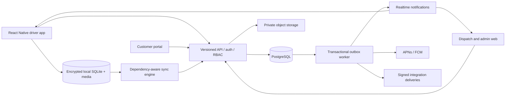
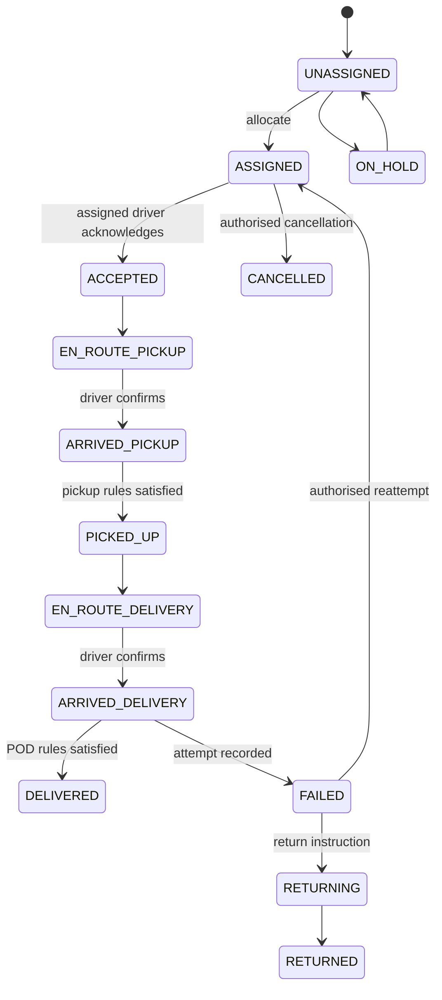

# RushIT — product architecture and delivery baseline

7 October 2026 · proposed architecture, with implementation status in `IMPLEMENTATION_STATUS.md`.

This independent product uses courier operational requirements as its benchmark. Screens, branding, workflows and source are our own. The earlier localStorage demo is a disposable research prototype, not the application foundation. This document covers all 27 first-task deliverables from the master prompt.

## 1. Product architecture

One organisation-scoped courier operating system: customer booking → dispatch allocation → driver execution → evidence acceptance → customer visibility → reporting. Separate booking, physical consignment, stops/legs, assignments and evidence. Start with a modular monolith and transactional outbox; separate services only when measured scale or ownership requires it. No production SICAB API is assumed.

Domain boundaries: identity/tenancy; booking/customer; dispatch/run; driver/shift; execution/package; evidence/POD; messaging/notification; fleet/location; reporting/billing; audit/integration. Each owns its writes. Domain events expose changes to other modules.

## 2. User-role matrix

| Role | Scope | Actions |
| --- | --- | --- |
| Platform super admin | Platform configuration | Provision organisations; support access only through explicit audited elevation |
| Organisation admin | Own organisation | Users, branches, depots, policies, customer settings, integrations |
| Operations manager | Authorised branches | Dispatch management, exception resolution, operational reports |
| Dispatcher | Authorised branches | Booking, assignment, sequencing, holds, cancellation, messages |
| Fleet manager | Authorised fleet | Vehicles, defects, capacity, maintenance |
| Finance | Authorised accounts | Rates, approved charges, billing, finance exports |
| Customer administrator | Own customer account | Customer users, bookings, contacts, tracking, permitted POD |
| Customer user | Own account | Booking and permitted job/evidence queries |
| Driver | Own current assignments | Shifts, acceptance, scans, pickup/delivery, evidence, incidents |
| Auditor | Explicit read scope | Read timelines, compliance and audit records |

Initial code implements organisation admin, dispatcher and driver. Other roles remain denied until their permissions and services are implemented. Every object access checks organisation and assignment/account scope on the server.

## 3. Driver workflow

Authenticate → select vehicle → start shift → available → receive assignment → review → accept → travel to pickup → confirm arrival → scan/check quantities → required pickup evidence → confirm pickup → travel to delivery → confirm arrival → verify items/recipient → required POD → submit → backend accepts → completed. A locally recorded completion is pending sync until acknowledged. Failures create attempts and exceptions, not successful deliveries. Finish shift respects pending work and organisation policy.

## 4. Dispatcher workflow

Authenticate → choose branch → review unassigned/urgent/delayed work → book or import → inspect driver availability/capacity → assign or reassign → driver acknowledges → monitor execution and evidence → resolve exceptions → close operational work. Manual actions and future recommendations share the same server command handlers. Cancelling or reassigning bumps assignment/resource versions and produces notifications. Drag/drop must have an accessible button equivalent.

## 5. Customer workflow

Authenticate within customer account → create booking with windows/handling requirements → validate service availability → receive reference → view permitted milestones → retrieve permitted POD → view history/report. Guest tracking uses a random scoped token, expires, can be revoked and never exposes internal instructions, full location history or unrestricted signatures.

## 6. Complete planned screen inventory

| Surface | Screens |
| --- | --- |
| Shared identity | Sign in, reset password, MFA, session/device management, access denied, outage/recovery |
| Driver | Branded loading, dashboard, vehicle selection/check, shift, break, jobs list/cards/map, filters/sort/manual order, run/route, job detail, pickup arrival, item scanner/manual fallback, item discrepancy, pickup evidence, delivery arrival, recipient, signature, photo preview, POD review, failed attempt, return, wait timer, history/POD, messages/thread, notifications/acknowledgements, incident/fatigue/vehicle issue, profile, privacy/location, sync queue/conflicts |
| Dispatch | Dashboard, fleet map/driver detail, jobs queue/detail/timeline, booking/edit, allocation board, run sequencing, recommendation review, failed attempts/exceptions, messages/broadcasts, alerts, evidence review, shift logoff approval |
| Admin | Organisation, branches, depots, users/roles, customers/contacts, drivers/devices, vehicles, services/custom fields, POD rules, location/retention policies, notification templates, integration credentials, audit, security/session review |
| Customer | Dashboard, booking, addresses/contacts, bookings/search/history, job tracking, POD view/download, account users, reports |
| Reporting | Completion/failure, on-time performance, wait time, productivity, distance, customer activity, POD compliance, export jobs |

Screens are planned inventory, not completed features. Do not show enabled controls for unsupported services.

## 7. System architecture diagram

## 8. Mobile architecture

Recommend React Native with TypeScript: native device APIs and shared typed contracts with the backend/web, while keeping presentation separate. Presentation → use cases → domain interfaces → adapters for HTTP, encrypted local database, secure credential storage, location, scanner, camera and push. Persist commands atomically with their outbox entry. Store media as files, not JSON base64. Background OS restrictions require native development builds and physical-device tests; a web/PWA review does not prove iOS/Android background reliability. The native app is not built in this milestone.

## 9. Backend architecture

HTTP transport → authenticated context → policy checks → input validation → domain command → transaction → events/audit/outbox → response. Queries use scoped repositories and pagination. External service calls do not run inside DB transactions. Workers use retries, dead-letter visibility and idempotent handlers. Error bodies contain stable codes, actionable messages and request IDs; logs exclude passwords, tokens and recipient media.

## 10–11. Database architecture and proposed schema

Production target: PostgreSQL with organisation composite foreign keys, indices and row-level security as defence in depth. Runtime foundation: file-backed SQLite, enabling reproducible local execution with the available Node runtime and no database installation. It is a single-instance development adapter, not the production scale solution. Initial executable schema is `apps/api/schema.sql`; broader PostgreSQL target is `docs/POSTGRES_SCHEMA.sql`.

Normalised relationships: organisation → branch → depot; user → role grants; driver → devices/shift/vehicle; customer → locations; job → legs → packages/scans; job → versioned assignment; leg → attempts/POD → evidence references; driver → location samples; conversation → messages; domain events → outbox/integration deliveries. Use UTC timestamps, explicit timezone, fixed-precision money and explicit measurement units. API schemas and workflow policies are versioned independently.

Index organisation/status/windows on jobs, organisation/driver/active on assignments, organisation/job/sequence on legs, organisation/job/event time on events, organisation/customer/reference on bookings, driver/location time on samples. Partition high-volume location/event data only after load tests justify it. Production uses non-owner DB roles; pool connections must set and clear tenant context per transaction.

## 12. Lifecycle/state machine

Server validates action, expected revision, assignment and required evidence; it never accepts an arbitrary client status. Every leg has its own progression/dependencies. Job aggregates derive from leg outcomes. Initial code supports single pickup/delivery, hold/cancel and failed reattempts; multi-leg aggregate execution remains a later milestone.

## 13. API structure

`/api/v1/auth`: login, current session, logout; later reset/MFA/device revocation. `/users`: scoped administration. `/jobs`: paginated scoped queries/create/detail; `/jobs/:id/assignment`, `/jobs/:id/actions`, `/jobs/:id/events`. `/shifts`: start/break/resume/finish. `/messages`: later threads/broadcast attachments. `/evidence`: staged upload/finalise/retrieve. Later: `/runs`, `/locations/batches`, `/sync`, `/customers`, `/tracking`, `/reports`, `/incidents`, `/vehicles`.

Commands carry idempotency key and expected version, plus device occurrence time and optional GPS accuracy/sample time. Replays return original result; reused keys with different request payloads fail. Unknown fields and invalid action names are rejected. No client-supplied organisation is trusted for authorisation. Later mobile tokens are scoped short-lived access credentials with rotating refresh tokens; browser sessions use HttpOnly cookies.

## 14. Realtime architecture

Initial foundation uses authenticated scoped Server-Sent Events carrying invalidation hints, with authoritative state fetched through normal queries. After disconnection, clients refetch; realtime is not a delivery guarantee. Production publication uses a transactional outbox and reconnect cursor. Mobile push wakes clients to fetch assignments, not to apply authoritative state. Dispatch acknowledgements and job revisions make missed notifications recoverable.

## 15. GPS architecture

Shift-scoped tracking policy, visible active indicator, adaptive sampling, movement/accuracy filters and sample timestamps. Break/finish stop tracking according to configured policy. Location batch intake validates assigned driver, organisation, freshness, coordinates and accuracy. Display stale positions explicitly. Geofences suggest arrival; only confirmed commands change status. Driver event GPS and continuous samples are separate records. No location is fabricated when unavailable. Choose provider and sampling from real-device battery tests.

## 16. Offline-sync architecture

Encrypted device SQLite caches only assigned operational scope; OS keystore protects keys. Domain command + outbox saved in one local transaction. Stable UUID per command, dependency order, resumable media transfers, bounded exponential retry with jitter. Reauthentication retains pending data. Resource/assignment versions prevent silent overwrites. Conflicts enter a visible queue preserving original events/evidence. Revocation removes read access without silently destroying unresolved evidence. Full resync includes tombstones; expired cursors safely recover. Finish/logout warns about pending work. Establish permitted offline duration and key destruction rules before pilot.

## 17. POD architecture

Versioned customer/service policy defines recipient, signature, photo categories, item scans, GPS/accuracy, PIN/OTP or ATL as required. Server resolves policy version captured at assignment and validates evidence belonging to the same organisation/job/driver. Capture records actor, device, occurrence/receipt time and permitted coordinates. Policy changes on offline work require explicit conflict resolution. POD is accepted only when required media upload is finalised and integrity checked. Amendments append superseding records with reason; original evidence is retained according to policy. OTP/PIN verification is server-side and rate-limited; never ship expected PINs to the client.

## 18. File-storage architecture

Private object store; DB holds IDs, owner/scope, category, content type, size, checksum and metadata. Random opaque object keys, upload authorisation, maximum sizes, type validation, malware processing and finalisation. Retrieval authorises before issuing short-lived signed access. Lifecycle retention/legal hold/export govern deletion. Local filesystem evidence adapter may support development but does not establish cloud encryption or immutable evidence. Do not store media in ordinary job records.

## 19–20. Authentication and RBAC architecture

Production prefer OIDC provider supporting MFA/passkeys and recovery. Local foundation uses scrypt password hashing with random salts, random opaque server sessions stored as hashes, HttpOnly SameSite cookies, expiry, revocation and origin checks for writes. Credentials are provisioned through a local interactive setup command, not fixed demo passwords. TLS and Secure cookies are required before internet deployment. Native token rotation/device registration is a later gate.

Effective permission = role capability ∩ organisation ∩ branch/account/assignment scope. Deny by default; drivers cannot allocate, change policies or access others' jobs. Admin privilege never crosses organisations. Audit privileged writes. Never derive role or company from request body. Tests must exercise direct API attacks, not merely hidden controls.

## 21. Threat model

| Threat | Control and validation |
| --- | --- |
| Cross-tenant object access | Scoped repositories, composite FKs, production RLS; negative tests |
| Stolen session/device | HttpOnly/secure storage, expiry/revocation, MFA and device controls |
| CSRF/XSS | SameSite + origin validation, output escaping, CSP, strict upload types |
| Forged status/POD | Server state machine, assignment/version checks, policy validation |
| Replay/duplicate commands | Transactional idempotency tied to actor, route and payload |
| Evidence tampering | Hashes, private storage, append-only amendments, retention policy |
| Upload abuse | Size/type checks, scoped finalisation, quota and malware processing |
| Excessive tracking | Shift policy, explicit consent/explanation, limited retention/access |
| Resource exhaustion | Rate limits, body limits, pagination and operational monitoring |
| Offline conflict/data loss | Durable queue, retained evidence, conflict resolution and restart tests |
| Privileged operator misuse | Least privilege, audited elevation, separation of financial duties |
| Integration compromise | Scoped credentials, secret manager, signed deliveries, rotation |

Remaining production risks: native credential/cache protection, TLS, provider recovery, managed storage, distributed rate limits, restoration, malware pipeline and independent security review.

## 22. Technology decisions

| Area | Target / rationale | Foundation choice |
| --- | --- | --- |
| Mobile | React Native + TypeScript; shared contracts with native modules | Planned; no fake native shell |
| Web | React + TypeScript; accessible domain screens and independent design tokens | Modular browser client for executable foundation, migrate after contracts settle |
| API | Node + TypeScript modular monolith; transactional domain handlers | Node built-ins + module-separated JS; no unsupported dependency installation |
| Database | PostgreSQL; transactional relational model and RLS | SQLite adapter on installed Node 24 |
| Realtime | SSE for web invalidation, native push; WebSockets when bidirectional demand warrants | Scoped SSE |
| Queue | DB outbox first, add managed queue when throughput demands | Planned durable outbox schema |
| Files | S3-compatible private storage through adapter | Planned; no public bucket |
| Maps | Provider adapter, navigation deep links first | Provider selection pending region/cost pilot |
| Cache | Redis when distributed cache/rate limits are needed | In-process rate limit only, single-instance |

References: [React Native architecture](https://reactnative.dev/architecture/overview), [PostgreSQL row security](https://www.postgresql.org/docs/18/ddl-rowsecurity.html), [Node SQLite documentation](https://nodejs.org/api/sqlite.html). These support capability evaluation, not a claim that the foundation is production-ready.

## 23. Repository structure

`apps/api/`: transport, auth, database, job domain and live events. `apps/web/`: current authenticated web foundation. `apps/mobile/`: later native application. `packages/domain/`: shared workflow contracts; `packages/design/`: tokens/icons later. `docs/`: architecture/schema/status and evidence catalogue. `tests/`: security, tenancy and workflow tests. `public/`: retained original prototype. `.data/`: ignored development DB and local runtime files. No generated credentials or operational media are committed.

## 24. Development milestones

M0 discovery/architecture: this document, evidence distinctions and baseline schema. M1 foundation: persistent identity/tenant model, sessions/RBAC, scoped web/API, tested state machine. M2 execution: native driver shell, packages/scans, shift/vehicle, evidence storage and policy POD. M3 live: assignment outbox, push, GPS, maps, messaging. M4 offline: encrypted cache, queue, conflict/recovery and media restart tests. M5 customers/admin/reporting: booking/tracking, roles/config and exports. M6 production: load/security/privacy review, deployment/monitoring/restore drills and real-device pilot.

Tests begin in M1 and accompany every milestone; they are not postponed to a final phase. Production deployment requires explicit review. All repository changes remain uncommitted for user approval.

## 25. MVP feature set

One organisation/branches, admin/dispatcher/driver/customer permissions, booking, allocation, one pickup/delivery, explicit shift/availability, state machine, barcode/manual fallback, required POD and secure media, messages, live web updates, assigned offline work/reliable sync, customer milestones, audit, basic reporting. A usable production MVP must pass native/offline/evidence gates; foundation alone does not meet this definition.

## 26. Phase-2 features

Multi-leg/linehaul/depot transfer, partial deliveries/returns, advanced POD/PIN/OTP, broadcast acknowledgements, vehicle checks/incidents/wait charges, geofence suggestions, configurable forms/custom fields, customer contacts/exports, route-order lock and dispatch recommendations, enterprise IdP and security controls.

## 27. Enterprise roadmap

Multi-organisation SaaS provisioning/billing, sophisticated tariffs/accounting, constrained routing and traffic ETA, demand/capacity forecasting, ERP/e-commerce adapters, retention/legal-hold controls, localisation, high-volume reporting pipeline, SLO/on-call tooling and disaster recovery. AI remains advisory with measurable quality and operator confirmation.
