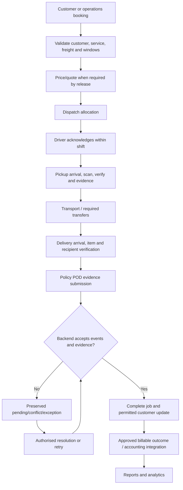
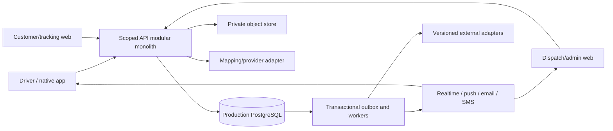
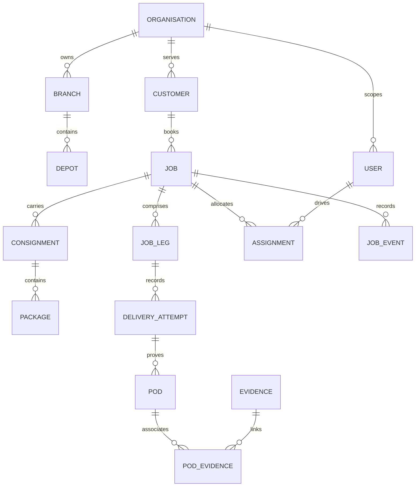

# Capability map, information architecture and business journeys

## Capability map and programme ownership

| Programme | Owner role | Objective/deliverables | Dependencies | Acceptance / main risk |
| --- | --- | --- | --- | --- |
| P1 Discovery/business analysis | PO/operations | Baseline, current-state research, requirement catalogue | Pilot participants | Verified processes; limited evidence |
| P2 Product/UX | PO/design lead | Personas, journeys, screen inventory, design tokens | P1 | Accessible user-tested tasks; driver distraction |
| P3 Platform foundation | Engineering lead | Identity, permissions, tenants, migrations, environments | P1/P2 | Negative access/recovery tests; tenant leakage |
| P4 Logistics engine | Domain lead | Booking, legs, packages, assignments, states/events | P3 | Validated item/transition invariants; edge cases |
| P5 Driver operations | Mobile lead | Native shift/scan/evidence/POD/offline/location | P3/P4 | Real-device run/recovery; data loss/battery |
| P6 Dispatch/customer | Web lead | Boards/maps/messages/tracking/customer views | P4/P5 events | Scoped updates/UAT; stale or overexposed data |
| P7 Commercial services | Finance/domain lead | Pricing/charges/accounting/adapters | Agreed service contracts, execution outcomes | Reconciliation; scope/contract complexity |
| P8 Security/QA/readiness | QA/security/support leads | Threat tests, CI, monitoring, restores, pilot/release | Every programme | Signed gate evidence; untested recovery |
| P9 Enterprise/intelligence | Product/architecture lead | SaaS/SSO/networks/analytics/recommendations | Proven operational release | Tenant/load/advisory controls; premature expansion |

Human role holders are not yet appointed. Milestones map to `DELIVERY_ROADMAP.md`; these are workstreams, not parallel agent assignments.

## Information architecture and screen register

Driver: identity/device → shift/vehicle/safety → home → jobs/list/card/map/run → job/legs → pickup/scanner/discrepancy/evidence → delivery/recipient/POD/signature/photo/ATL → failure/return → history; global messages, notifications, incident/profile/privacy/settings/sync/conflicts.

Dispatch: overview → queue/job detail/timeline → driver board/detail → allocation/run order → map → exceptions → messages → operational reports.

Admin: organisation/branch/depot → people/roles/devices → fleet/customer/contacts → services/custom fields/POD rules → templates/integrations/security → audit.

Customer: account → booking/quote/drafts → jobs/detail → tracking/POD/history → addresses/contacts/reports; public tracking is a separate restricted surface.

Platform: tenant plans/provisioning/features/usage → health/support → security/abuse → subscriptions. Screens beyond the foundation remain planned. Detailed inventory: `../PRODUCT_ARCHITECTURE.md` section 6; observed evidence: `../screens/SCREEN_CATALOGUE.md`.

## End-to-end process

Price/quote, transfers and accounting are eventual platform steps; first-release applicability is defined in the scope document. Offline local acknowledgement is never represented as backend acceptance.

## Driver journey

Login/device validation → shift/vehicle/configured safety check → available → assignment review → acknowledge → external navigation → confirmed pickup arrival → scan/verify freight → required pickup evidence → collected → navigate → confirmed delivery arrival → scan/address/recipient verification → policy evidence → locally durable submission → server acknowledgement → next work → finish shift. Any pending sync/conflict is visible. Optional tracking obeys shift/break policy. Device/vehicle/safety/native/offline steps are planned, not current implementation claims.

## Dispatcher journey

Sign in/branch → inspect drivers and queue → create/validate booking → choose service/policy → allocate → receive driver acknowledgement → monitor status/stale positions → act on delayed/failed/discrepant work → authorise retry/hold/return → review permitted evidence → close outcome → report. Reassignment preserves previous events and rejects stale authority. Every override has an actor/reason.

## Customer journey

MVP: receive scoped tracking link → view permitted milestones → view completion/exception and permitted POD information. Phase 2: account login → quote/book/draft/repeat → manage contacts/sites → track → retrieve permitted evidence/history/report/invoice. Do not expose internal notes or unrestricted driver identity/location.

## Job and exception lifecycle

Logical commercial phases: draft/booking validation → dispatch → pickup → transport → delivery → evidence accepted → operational closure → billing. Exact operational statuses are domain design decisions; avoid blindly adopting benchmark status text. Current implemented state machine is documented in `CODEBASE_REVIEW.md`.

Exception: detect → record reason/items/evidence/actor → preserve freight custody and original events → assign dispatch owner → decide retry/hold/return/transfer → record compensating command → execute outcome → resolve with audit. Partial outcomes and multi-leg custody need their own records before implementation. Original POD is never silently overwritten during resolution.

## System context and container view

Development currently uses SQLite, browser UI and direct SSE invalidation. Target diagram components are not all implemented. Mobile/backend/database/file/auth/offline/GPS designs remain in `../PRODUCT_ARCHITECTURE.md`; execution gaps remain in the review.

## Proposed ERD boundary

ERD illustrates the target relationships, not an assertion that current runtime includes every entity. Production DDL is proposed and requires migration execution/testing.
