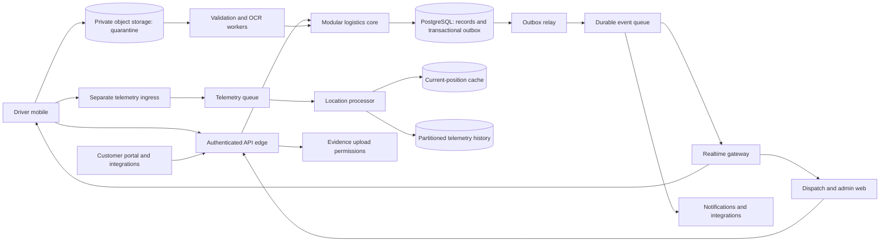
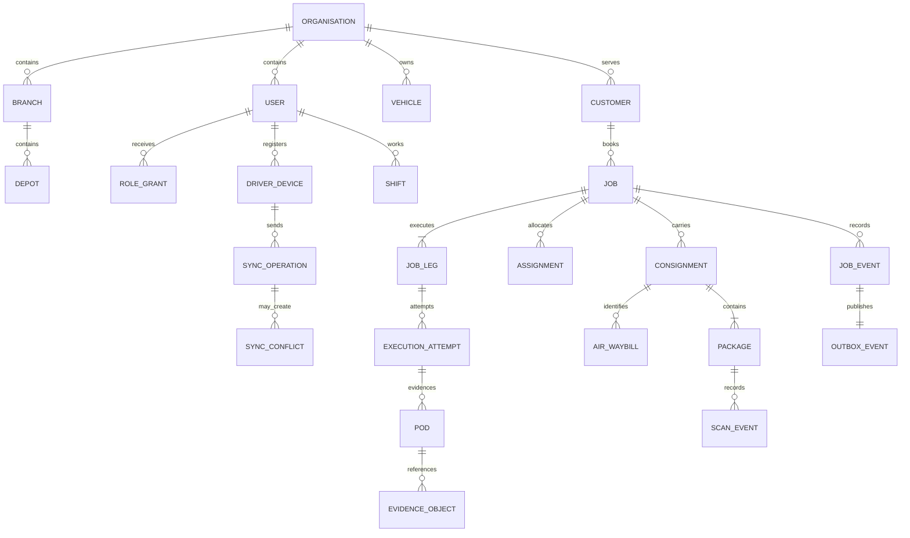
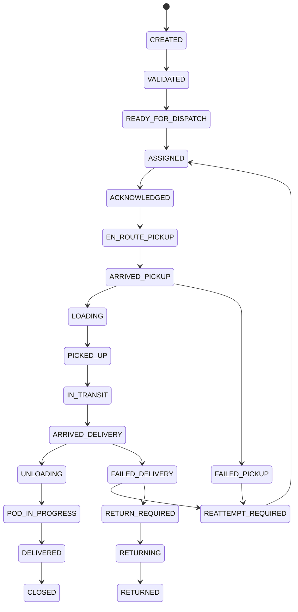

# Rush IT — Enterprise Solution Blueprint

10 October 2026 · Design baseline for review · Not production approval

This document answers Parts A–Y of the enterprise delivery prompt in order. The supplied project plan is input, not evidence that its architecture is implemented. Current implementation evidence is in [the readiness assessment](ENTERPRISE_READINESS.md). Existing product and compliance documents remain useful; this baseline supersedes conflicting enterprise planning assumptions, not tested application behaviour. No deployment, expenditure, Git staging, commit or push is authorised by this document.

## PART A — Executive Understanding

Rush IT is a multi-tenant logistics operating platform: booking → validation → dispatch → assignment → pickup → cargo/depot transfers → delivery → accepted POD → exceptions → reporting and, later, billing. Users include drivers, dispatchers, depot staff, fleet and operations managers, customers, finance, tenant administrators, auditors and platform support. Operational correctness during disconnection and reassignment matters more than adding screens.

The brief's initial planning envelope is 2,000–3,000 daily operational users, approximately 60,000 daily driver-job assignments/interactions and 5,000 concurrent realtime connections, with later 20,000+. These are targets, not demonstrated capacity. The existing Node/SQLite web application is a local working reference for booking, cargo, scanning and POD; it is not this production platform.

## PART B — Assumptions & Unknowns

| ID | Assumption / unknown | Consequence / validation owner |
| --- | --- | --- |
| A01 | Australian operation and hosting preferred; residency not confirmed | Compliance and PO determine customers, jurisdiction and cross-border processing before cloud selection |
| A02 | Driver iOS and Android applications required | Mobile lead inventories supported devices, OS versions, scanners, distribution and background restrictions |
| A03 | Eight hours offline is a design test; maximum shift/offline duration unknown | SME validates custody, safe execution after cancellation, offline authorisation expiry and recovery escalation |
| A04 | 60,000 interactions are not necessarily distinct jobs | BA measures unique jobs, assignments, stops and interactions separately |
| A05 | Four packages and two photos per distinct job are modelling assumptions | Data engineer samples pilot freight and actual compressed images |
| A06 | 2,500 drivers operate eight hours; 15–30 second moving GPS assumed | Fleet/PO validate driver fraction, battery cost, tracking purpose and collection windows |
| A07 | Branch/depot and customer account access required | Security/SME validate cross-branch dispatch and customer visibility matrix |
| A08 | Cloud, identity, maps and push providers unselected | Architect evaluates residency, capabilities, operating cost and team experience |
| A09 | Returns, failed pickup, multi-leg custody and dangerous goods required eventually | SME defines rules and required training; restrict unsupported freight in pilot |
| A10 | Delivery dates below are sequencing windows, not estimates or commitments | PM establishes staffing, budget, operational availability and acceptance owners |

Further unknowns: actual retention schedules, integrations and API ownership, customer rules, billing priority, fleet capacity constraints, AWB uniqueness by carrier, document rights, restore scope, accessibility needs and launch geography. Record answers as decisions with evidence rather than embedding guesses in code.

## PART C — Stakeholder Architecture

Sponsor owns funding and acceptable operational risk; PO owns scope and acceptance; PM owns dependencies and delivery reporting. Driver and dispatcher representatives validate workflows. Depot/fleet/customer/finance representatives own their operational rules. Architect owns consistency across domains. Security and compliance assess controls and purpose/retention. QA owns independent evidence. Support owns incident response and runbooks. External carriers, identity/maps/cloud providers and customer integrators are dependencies with contracts, not implicit members of our trust boundary.

## PART D — Product Capability Map

| Capability group | Components | Release boundary |
| --- | --- | --- |
| Foundation | Identity, organisations/branches/depots, scoped permissions, devices, audit, observability | Required before pilot |
| Logistics | Booking, customers, jobs, legs/attempts, assignments, cargo/AWB/packages, scans, pickup/delivery, POD, failures | First complete vertical slice |
| Driver | Shift, vehicle checks, cached work, offline outbox, evidence, safety, GPS and notifications | Required before pilot |
| Operations | Dispatch, workload, exception resolution, depot custody and fleet | Basic dispatch first; advanced custody/fleet later |
| Customer | Booking, account-scoped milestones, permitted POD, customer API | Minimal retrieval in vertical slice; full portal R1 |
| Commercial | Rates, approved charges, billing, settlement | R2 unless pilot contract requires earlier |
| Enterprise | Integrations, reporting, search, route advice, SSO, partner networks, analytics | Progressive, following validated foundations |

## PART E — 23-Person Team Structure

Planning allocation, not a claim that these people are hired or agents are running: PM, PO, BA (3); principal architect (1); backend lead and three engineers (4); mobile lead and two engineers (3); frontend lead and two engineers (3); platform engineer, security engineer, data engineer (3); QA lead and two engineers (3); UX designer, logistics SME, compliance/support-readiness specialist (3). Total 23. Leads coordinate through architect; PM tracks delivery; PO resolves product priority. Security, QA and compliance retain independent escalation to release governance.

## PART F — RACI Matrix

| Area | Accountable | Responsible | Consulted | Informed |
| --- | --- | --- | --- | --- |
| Product | PO | BA, SME | UX, PM, customer representatives | All leads |
| Architecture | Architect | Technical leads | Security, data, platform | PM, PO, QA |
| Backend | Backend lead | Backend engineers | Architect, data, SME | Mobile/web/QA |
| Mobile | Mobile lead | Mobile engineers | UX, security, backend | PM, QA |
| Frontend | Frontend lead | Frontend engineers | UX, backend, security | PM, QA |
| Database | Architect | Data engineer | Backend, platform, security | QA, PM |
| Security | Security engineer | Security and domain engineers | Compliance, architect | PM, PO, QA |
| Infrastructure | Architect | Platform engineer | Security, data | All leads |
| QA | QA lead | QA engineers and feature engineers | SME, security, UX | PM, PO |
| Compliance | Compliance specialist | Compliance specialist | Security, SME, legal adviser | PM, PO |
| Release | PO | PM, platform, QA | Architect, security, compliance, operations | Sponsor, support, customers |

## PART G — Workstreams

Eight streams: discovery/product; architecture/contracts; backend; driver mobile; dispatch/admin/customer web; platform; quality; security/compliance. They share versioned contracts and a single domain transition specification. Architecture/security/data establish tenant, event and sync invariants before dependent implementation. UI exploration and operational observation can run concurrently. QA authors failure scenarios alongside contracts. Integration demonstrations use real APIs and isolated synthetic tenants.

## PART H — Non-Functional Requirements

| ID | Proposed initial target | Measurement / acceptance |
| --- | --- | --- |
| N01 | 99.9% monthly core API availability | External authenticated synthetic booking/execution probes; agreed exclusions; 43.2 minutes budget in a 30-day month |
| N02 | Typical API p50 <150 ms, p95 <500 ms, p99 <1.5 s | Per route at agreed peak mix; exclude asynchronous processing and large media transfer; measure client and service latency separately |
| N03 | Dispatch changes visible within 2 s normally | Commit-to-authorised-client acknowledgement distribution; degraded polling threshold measured separately |
| N04 | 5,000 concurrent realtime sessions, later 20,000+ | Realistic tenant/assignment subscriptions, reconnects, revocation and memory soak |
| N05 | No silent loss or duplicate accepted evidence/operations | Kill/restart/retry/reassignment suite; accepted receipt remains durable; unaccepted work visibly pending/conflicted |
| N06 | RPO ≤15 min, RTO ≤2 h | Restore drill including DB, object manifests, keys and service recovery; not backup checkbox |
| N07 | Privileged MFA and 100% privileged changes audited | Role/action catalogue coverage and session tests |
| N08 | Accessible driver/portal workflows | Keyboard, screen reader, contrast and real-device usability checks; no operational interaction while driving |

All targets require operational validation and load evidence. Nothing in the current local app demonstrates these SLOs.

## PART I — Scale Model

Let I=60,000 interactions/day, k=interactions per distinct job, J=I/k, P=4 packages/job, F=2 photos/job, B=600,000 bytes/photo. Illustrative central scenario k=6 gives J=10,000; conservative high-volume envelope k=1 gives J=60,000. k is unmeasured. The supplied plan's 480,000 scans and 72 GB/day are the upper envelope, not inevitable baseline.

| Quantity | Central illustrative scenario | High-volume envelope |
| --- | --- | --- |
| New packages/day, J×P | 40,000 | 240,000 |
| Pickup+delivery scans/day, J×P×2 | 80,000 | 480,000 |
| Images/day, J×F | 20,000 | 120,000 |
| Images/year, ×365 | 7.3 million | 43.8 million |
| Media/day, images×B | 12 GB | 72 GB |
| Media/year, ×365 | 4.38 TB | 26.28 TB |
| GPS/day, 2,500×8×3,600/frequency | 2.4 million at 30 s | 4.8 million at 15 s |
| GPS active throughput | 83.3 events/s | 166.7 events/s |

Storage numbers use decimal units and exclude signatures, original documents, replication, backups and retention expiry. At 500 bytes/location before indexes GPS is 1.2–2.4 GB/day. Illustrative relational estimate: 5 KB/job + 1 KB/package + 1 KB/scan + 1 KB each of ten workflow events = 27 KB/job, or 0.27–1.62 GB/day before indexes/WAL/replicas. Measure real rows; do not provision on estimates alone.

Initial peak test assumptions: 1,500 logins over 60 s =25/s plus five bootstrap reads each=125/s; 10,000-job import over five minutes=33.3 jobs/s in an isolated worker lane; 500 devices×200 queued commands over five minutes=333.3 commands/s, excluding GPS/media; 500 reassignments over 60 s=8.3/s plus fanout. Test independently and combined with normal traffic. Queue input may be batched; command validation/write demand remains.

At 1×, prioritise primary DB contention, password hashing CPU and upload bandwidth. At 2×, pool/query tuning and autoscaled workers; at 5×, realtime fanout, reconnect fairness and telemetry partitioning; at 10×, primary write capacity, tenant skew, object throughput and reporting isolation. Each scale factor multiplies event rates, not every resource blindly. Benchmark before extracting further core services. Cost model must include object retention/egress, backup copies, telemetry retention, queue requests, identity MAU, maps/navigation and observability ingestion.

## PART J — Architecture Options

| Option | Benefits | Costs / failure considerations |
| --- | --- | --- |
| Modular core with workers in one deployment | Simple transactions, fewer deployments, quickest domain iteration | GPS/OCR/upload bursts compete with driver requests; deploy blast radius |
| Modular core plus separate workload services | Core transactions stay coherent; GPS, media, realtime and imports scale independently | Queue contracts, tracing, eventual consistency and more operating responsibility |
| Fully distributed business microservices | Independent team deploys where justified | Distributed consistency, duplicate events, operational burden and expensive premature boundaries |

Recommend hybrid: one modular transactional logistics core; separately deployed telemetry ingress, realtime gateway, media/OCR and notification/integration workers. Do not split booking/assignment/POD into distributed transactions initially. TypeScript core and web, React Native driver and PostgreSQL are candidates, not approved selections. Preserve the current tested domain rules as migration acceptance fixtures; do not rewrite working behaviour without comparison.

## PART K — System Architecture

Context boundary: users and external partners access only published API/portal capabilities; no direct database or unrestricted object access. Core components: identity adapter, tenant/permission resolver, command validation, jobs/transport/packages/evidence modules, audit and event repository. A transaction updates the entity/version, append-only event, audit and outbox. Response indicates accepted server state; realtime happens afterward. Media readiness and telemetry are independent workflows.

## PART L — Domain Architecture

Identity owns credentials/sessions/devices; organisation owns tenant/branch/depot; workforce owns qualifications/shifts; fleet owns vehicle availability/defects; customers owns account/location/POD policy; jobs owns booking/priority; transport owns stops/legs/attempts/custody; dispatch owns assignments/versioning; cargo owns consignment/AWB/handling; packages owns items/barcodes/scans; evidence owns uploads/verification/POD; location owns shift-scoped telemetry; messaging owns conversations; notification owns delivery attempts; finance owns rates/charges/invoices; audit owns protected privileged history; integration owns imports/webhooks; reporting owns rebuildable projections. No module changes another module's tables through ad hoc queries.

## PART M — Data Architecture

Every business record has tenant_id. Tenant-qualified unique keys and composite foreign keys prevent cross-tenant relations. Shared PostgreSQL schema plus application scope and RLS is proposed initially; privileged service roles must not bypass RLS on routine requests. Transaction-local tenant context comes from verified membership, never a client tenant ID; pool reuse must not carry tenant context. Test background jobs and exports equally. Dedicated databases remain an option for contractual isolation and tenant restore requirements.

Production schema needs branch/depot grants, assignment history, explicit attempt IDs, typed cargo identifiers/parties, many consignments/job and multiple legs. AWB/MAWB/HAWB are separate typed identifiers with issuer/carrier and parent relationships, not interchangeable job IDs. Packages hold count, unit, dimensions, actual/volumetric/chargeable weights, handling classes and validated dangerous-goods references. JSON extensions require versioned schemas, size limits and designated ownership; core searchable fields remain relational. Existing POSTGRES_SCHEMA.sql is an earlier proposal, not an applied migration.

Index tenant+status+created/job ID, tenant+branch+deadline, tenant+assigned-driver+active, tenant+barcode, tenant+cargo identifier/issuer and tenant+event sequence. Use bounded cursor pagination; cap pool connections across replicas below database capacity. Partition high-volume telemetry and measured event history by time, preserving tenant keys; do not partition every table prematurely. Reports use projections/read replicas; read-after-write operational decisions use primary. Retention by data category requires approved purpose/schedule, legal holds, deletion propagation and restricted archives. Evidence objects, database metadata and encryption keys require consistent restore.

## PART N — Job State Machine

States above describe a proposed execution lifecycle; loading/unloading may be leg progress rather than mandatory global job states after SME validation. Ready-for-dispatch with no active assignment represents unassigned work. Hold/cancel permitted before irreversible custody, with explicit exception rules thereafter. Damaged/disputed are exception records that may coexist with custody state. No enum rollout until every migration, transition and old-client mapping is specified.

Server checks action permission, tenant/resource scope, active assignment generation, attempt ID, expected version, shift/device status, package completeness and customer evidence policy. Reassignment closes the old assignment; never mutates its history. Reattempt creates a new attempt and requires new scans/evidence. Failure records reason, custody and next operational task; return creates linked return legs. Incidents can be reported without falsely completing a job. DELIVERED requires accepted POD and validated objects; CLOSED is operational settlement, not a driver's button.

## PART O — Offline & Synchronisation Architecture

Native encrypted local database plus OS protected key; cached assignments, job/leg/attempt versions and policy snapshots. Record command and evidence manifest durably in the same local transaction as local progress before showing confirmation. UI separates recorded on device, uploading, accepted and needs review. No sensitive cache in ordinary browser localStorage.

Command envelope: schemaVersion, operationId, deviceId, assignmentId/generation, entityId, attemptId, expectedVersion, clientSequence, capturedAt, operationType, payload and evidenceManifest hashes. Actor/tenant are derived on server. Monotonic per-job sequence and dependsOnOperationId support multiple offline actions without guessing future server versions. Submission is bounded; operations for one aggregate remain ordered, unrelated jobs process independently. GPS and binaries use separate lanes.

Server atomically inserts tenant+device+operation unique receipt, validates permissions/current assignment/version/rules, applies command, event/audit/outbox, stores result and commits. Lost response retransmission returns the same receipt; altered payload with the same ID rejects. A dependent command advances only after predecessor acceptance. ACK includes accepted event ID/version/server time; CONFLICT includes safe current assignment/version and review reason, not another driver's private data. Rejected evidence stays encrypted on-device until acknowledged quarantine/review or authorised disposition. Never blind last-write-wins.

Version conflicts require refresh/revalidation; stale assignment or revoked device is server-authoritative for execution but locally captured evidence must be preserved for authorised review. Repeated barcode on the same package/attempt/stage returns prior acceptance. Distinct notes can append; custody/completion cannot auto-merge. Authentication expiry pauses sending and requests sign-in without deleting pending work. Device revocation denies upload APIs; operations arrange a supervised evidence recovery procedure. Backoff with jitter, Retry-After, bounded concurrency and tenant fairness limit 500-device recovery storms. Eight-hour recovery, app kill, reboot, clock skew and interrupted uploads are acceptance gates, not current capabilities.

## PART P — Real-Time Architecture

Commit → transactional outbox → leased relay → durable queue → authorised gateway → client delivery/acknowledgement. At-least-once delivery means consumers deduplicate event IDs. Event envelope includes schema version, tenant, aggregate ID/version, event ID, actor/device, capture/receive times, correlation/causation IDs and allowlisted metadata; sensitive media and credentials stay out of events.

Maintain per-subscription cursors and bounded retention; replay rechecks current visibility, particularly reassignment. If cursor has expired, perform scoped snapshot reconciliation rather than pretending no change occurred. Gateway failure degrades to bounded polling; Redis/cache failure must not erase assignments or become a reason to bypass authorisation. Mobile push is a hint; authoritative state is API/DB. Outbox relay failures leave committed events pending, monitored by age. Existing SSE invalidation is not durable delivery.

## PART Q — GPS Architecture

Separate authenticated ingress validates device/shift, numeric ranges, age, accuracy, timestamp skew and batch size; queue processors update latest position only if newer, and append historical data. Deduplicate device/sequence, flag improbable movement and document GPS as fallible evidence. Moving frequency 15–30 s is a test assumption; reduce frequency when stationary, on break or low battery within approved policy. Show tracking state and stop collection outside authorised work. Customers receive permitted milestones/limited tracking, never full private routes. Queue/cache failure degrades map freshness visibly; no fabricated current position and no job-row update for every fix.

## PART R — Security Architecture

Trust boundaries: device/browser, internet edge, authenticated API, private services/stores, object upload quarantine, external integrations and administrative/support access. Password hashing alone is insufficient: choose identity provider/verified OIDC integration, privileged MFA, short-lived access, refresh rotation/reuse detection, registered-device revocation and audited emergency access. Biometrics unlock OS-held credentials; do not claim Face ID from a browser graphic.

| Principal | Permission examples | Scope |
| --- | --- | --- |
| Organisation admin | user.manage, policy.manage, branch.manage | Own organisation; step-up for sensitive actions |
| Dispatcher / operations | job.create, job.assign, exception.resolve | Granted branch/depot and resource |
| Driver | assignment.ack, scan.record, execution.advance, pod.submit | Current own assignment/attempt, active device and work policy |
| Depot manager | custody.receive, custody.release | Granted depot and manifest |
| Fleet manager | vehicle.manage, defect.resolve | Granted fleet; no POD override |
| Finance | charge.review, invoice.issue | Granted customer/branch; no execution modification |
| Customer user/admin | booking.create, job.read, pod.read, customer.user.manage | Own customer account; admin permission separate |
| Auditor | audit.read, evidence.read | Explicit read-only scope and purpose |
| Platform/support | platform.configure; temporary support.read | No routine tenant access; approval/time limit/audit for elevation |

Threats and controls: tenant/IDOR → composite keys, RLS, object scope and negative tests; stolen sessions/devices → MFA, rotation, revocation, protected keys; forged completion/replay → assignment/version/attempt checks and durable receipts; malicious uploads → bounded upload tokens, allowlisted formats, quarantine/scanning, safe decoders; GPS spoofing → anomaly flags, no sole proof; insiders → least privilege, protected audit and elevation; XSS/CSRF → escaping/CSP/origin controls; integration SSRF → destination controls and egress restriction; dependency compromise → lockfiles, scanning, SBOM and reviewed provenance. Current local encryption is not managed key custody or certified compliance. Evidence includes digest, object version, uploader/device, capture/receive times, policy and retention/hold status.

## PART S — Cloud & Deployment Architecture

Provider decision remains open. Proposed vendor-neutral topology: edge CDN/WAF/TLS; multi-zone stateless API and realtime replicas behind load balancer; separate autoscaled workers; private managed PostgreSQL primary/standby with point-in-time recovery; private cache; durable queues and dead-letter queues; private object storage; managed secret/key service; central telemetry. No public database/cache. Separate cloud identities, networks and data for production; synthetic lower-environment fixtures. Single region initially with tested backup recovery; cross-region active-active core would increase custody consistency and cost complexity.

Infrastructure as code owns network, service identities, compute, stores, alerts and budgets. CI runs syntax/types/contracts/tenant tests/dependency scans and produces versioned artifacts. CD promotes the same immutable artifact, applies backward-compatible expand/contract migrations, health/synthetic gates, then canary rollout. Rollback app independently; do not reverse a destructive data migration blindly. Key revocation/rotation, backup lifecycle and least-privilege grants are explicit runbooks. Provider-specific implementation waits for ADR-001; none is deployed here.

## PART T — Observability & Support

Structured logs redact credentials/evidence/PII; propagate request, trace, event and operation correlation. Monitor route latency/error rates, pool wait/locks, outbox oldest age, queue backlog/dead letters, gateway connections/reconnects, sync pending age/conflicts, object validation failures, OCR latency and device crashes. Business alerts include unacknowledged assignment, late pickups/delivery, failed attempts, unresolved custody, stale driver sync and POD rejection. Metrics have bounded labels; no per-job or email metric labels.

Initial alert proposals: sustained core error-budget burn→SEV1/2; oldest committed outbox >60 s→SEV2; sync backlog >15 min for active driver→operations investigation; repeated upload validation failure→security/quality triage. Tune thresholds with pilot data. SEV1 broad operational outage; SEV2 critical degraded function; SEV3 limited impact; SEV4 minor issue. Incident commander coordinates recovery, operations communicate workarounds, engineers preserve evidence, and post-incident review creates owned corrective actions.

Runbooks: database failover/pool saturation; replay stuck outbox; recover sync conflict/evidence; revoke stolen device; storage/queue outage; failed import; roll back release; restore encrypted DB/media/keys; privacy incident. Each requires trigger, authorised owner, safe commands, evidence capture, verification and escalation contact before pilot.

## PART U — Testing Strategy

Current local tests validate existing behaviour, not the enterprise NFRs. Production gates require: unit transition/cargo rules; real PostgreSQL migration/RLS/integration tests; API contracts and role/resource matrix; E2E customer/dispatch→driver→POD→permitted customer retrieval; physical iOS/Android scanner/camera tests; accessibility/usability observation; offline kill/reboot/eight-hour queues; duplicate/reordered/conflicting commands; token expiry/revocation; interrupted media and quarantine; queue/cache/gateway/storage/DB failures; restore drills and peak soak tests.

Load scenarios from Part I run against production-like isolated infrastructure, with p95/p99, errors, queue-drain time, data-integrity checks, fairness and costs reported together. A fast response that silently drops an operation fails. Security gate covers cross-tenant relations, RLS connection reuse, customer/POD scope, websocket replay visibility, upload bypass, brute force/replay and administrative escalation. SME and PO accept pilot workflows only after QA/security/compliance evidence is reviewed; no invented approval.

## PART V — Delivery Roadmap

Phase 0: validate scope/scale, workflows, ADRs, threat model and acceptance. Foundation: tenant DB/migrations, identity, permissions, devices, audit/outbox/contracts, CI, storage and monitoring. MVP: complete booking/cargo/assignment/scan/POD/offline/basic-GPS slice plus customer evidence retrieval and safe failure/reattempt. Pilot: limited supervised operators and accounts with support/restore drills. R1: richer customer portal, depot/multi-leg custody, fleet, integration/webhooks and advanced evidence. R2: routing advice, pricing/billing, enterprise SSO and analytics. Expansion: tenant-specific isolation, partner network and settlement as evidence warrants. Advanced AI never overrides custody/evidence rules automatically.

## PART W — Critical Risks

| Rank | Risk | Likelihood | Impact | Mitigation | Accountable role |
| --- | --- | --- | --- | --- | --- |
| 1 | Cross-tenant or customer evidence leak | Medium | Critical | RLS/composite keys, scope tests, reviewed support access | Security |
| 2 | Offline evidence lost or falsely accepted | High | Critical | Durable encrypted queue/receipts, kill/reboot recovery | Mobile lead |
| 3 | Reassignment corrupts custody/state | Medium | Critical | Assignment generations, attempts, versioned commands | Backend lead |
| 4 | Compromised driver/admin device | Medium | Critical | MFA/device revocation and recovery runbook | Security |
| 5 | Sync/import bursts starve dispatch | High | High | Separate worker lanes, quotas, jitter and load test | Architect |
| 6 | GPS volume overload/cost/privacy | High | High | Separate pipeline, adaptive collection, bounded retention | Platform/compliance |
| 7 | Media malware or growing storage bill | High | High | Quarantine, validation, lifecycle and budgets | Platform |
| 8 | Backup cannot restore media or keys | Medium | Critical | End-to-end restore drills with manifests/key custody | Platform |
| 9 | Poor driver usability creates missed milestones | High | High | Field observation, safe minimal actions, physical-device UAT | UX/SME |
| 10 | Gateway/cache failure hides assignment changes | Medium | High | Replay/snapshot/polling; freshness warnings | Backend lead |
| 11 | Report/integration load harms core | High | High | Async imports, read models, quotas | Data engineer |
| 12 | Scope expansion prevents coherent MVP | High | High | Vertical-slice gate and change register | PO/PM |
| 13 | Mapping/provider outage blocks work | Medium | Medium | Cached instructions, external navigation fallback | Architect |
| 14 | Undefined retention/legal obligations | Medium | Critical | Purpose/schedule/holds and jurisdiction review | Compliance |

## PART X — Architecture Decision Register

All decisions are proposed/open until recorded review; role owners are not named appointees. Production code must not silently select providers or create subscriptions.

| ID | Decision / recommended candidate | Alternatives and consequence | Owner / validation / revisit |
| --- | --- | --- | --- |
| 001 | Cloud/region: evaluate Australian managed services | AWS/Azure/GCP; cost/residency/team skills, no preference assumed | Architect/compliance; cost and restore exercise; new residency contract |
| 002 | Mobile: React Native candidate | Flutter/native; plugin/OS support and maintenance | Mobile lead; offline/background/scanner spike; unsupported device |
| 003 | Backend: TypeScript modular framework candidate | Existing Node modules, NestJS, other team stack | Backend lead; migration/transaction benchmark; team/runtime constraint |
| 004 | Hybrid modular architecture | Single deployment or full microservices | Architect; workload isolation test; measured core bottleneck |
| 005 | Tenant-qualified shared schema + RLS | Schema/database per tenant | Security/data; tenant-escape/pool tests; contractual isolation |
| 006 | Managed PostgreSQL multi-zone + PITR | Self-managed DB, dedicated tenant DB | Data/platform; migration/restore/pool tests; capacity/restore limits |
| 007 | Partitioned GPS history + latest cache | Managed telemetry store | Data; write/retention cost benchmark; analytical growth |
| 008 | Durable managed queue with replay/DLQ | Broker/stream choices | Platform; duplicate/order/failure tests; retention/throughput changes |
| 009 | Separate realtime gateway with durable cursor | SSE/polling/managed realtime | Backend/platform; 5k reconnect test; 20k expansion |
| 010 | OIDC identity with privileged MFA | Managed provider versus operated identity | Security; revocation/rotation/device tests; customer SSO needs |
| 011 | Private object store + quarantine/managed keys | Local encrypted blobs unsuitable for production | Platform/security; interrupted upload/restore/access tests; region/retention change |
| 012 | Maps/navigation provider open | At least two vendors; costs and coverage | PO/architect; operational route trial; outages/cost |
| 013 | Encrypted mobile SQLite + OS key custody | Supported native encrypted stores | Mobile/security; reboot/key-loss/revocation trial; OS changes |
| 014 | Ordered offline commands + durable receipts | Last-write-wins rejected for custody | Backend/mobile; conflict/replay/8h tests; new aggregate types |
| 015 | Operational projections/read replica; analytics later | Primary reporting rejected for heavy jobs | Data; projection rebuild/lag tests; BI requirements |
| 016 | Indexed relational search initially | Search engine for proven full-text needs | Backend/data; realistic query benchmark; volume/features |
| 017 | OCR async extraction with human verification | Existing local OCR vs managed engines | Backend/compliance; representative document accuracy/cost; new layouts |
| 018 | Relational consignment/AWB/package/leg/attempt model | Unstructured freight JSON inadequate for core scope | Data/SME; real manifest mapping; new freight type |

For each approved ADR record context, options, decision, status/date, owner, security/privacy, performance/scale, operating cost, failure behaviour, migration consequences, validation evidence and revisit trigger. Candidate entries above are not claims that technologies were approved or implemented.

## PART Y — Next 30/60/90 Day Plan

Days 1–30: operational observation, establish interaction/job counts, MVP exclusions, tenant/customer rules, field workflows, UX journeys, threat model, capacity model, ADR review and backlog acceptance. Exit: coherent approved contracts and accountable release owners.

Days 31–60: production-like development foundation with migrations, identity/permissions/devices, audit/outbox, queue/object storage and observability; mobile encrypted outbox shell; web shell; CI/contracts and tenant/failure tests. Exit: denied cross-tenant actions, replay-safe commands, restored backup and real-device persisted offline operations.

Days 61–90: one end-to-end operational slice, including cargo extraction review, assignment, pickup scans/evidence, delivery scans/POD, customer-scoped retrieval, exceptions and offline recovery. Measure peak workloads, conduct field UAT, restore/failure drills and supervised pilot readiness. Timings depend on staffing/procurement; none is a promised completion date.

The immediate implementable sequence is detailed in [Sprint 0–2 backlog](ENTERPRISE_BACKLOG.md). The [readiness and coverage index](ENTERPRISE_READINESS.md) separates existing code from the 95 blueprint obligations and unvalidated production work.
